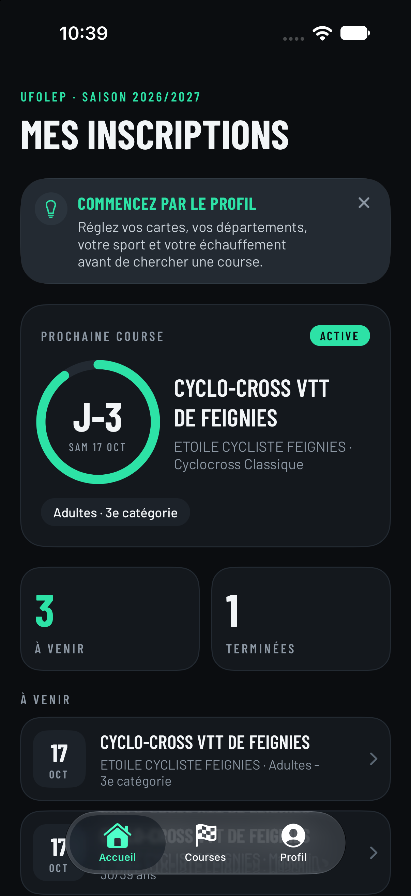
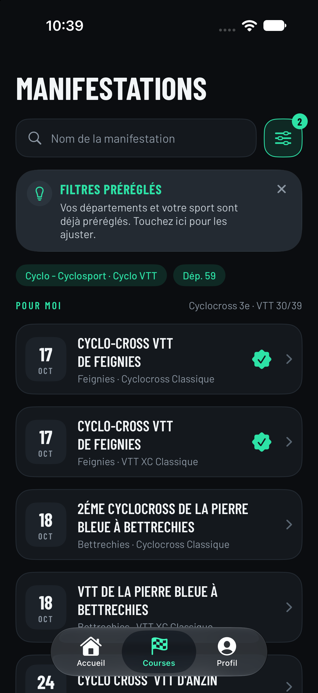
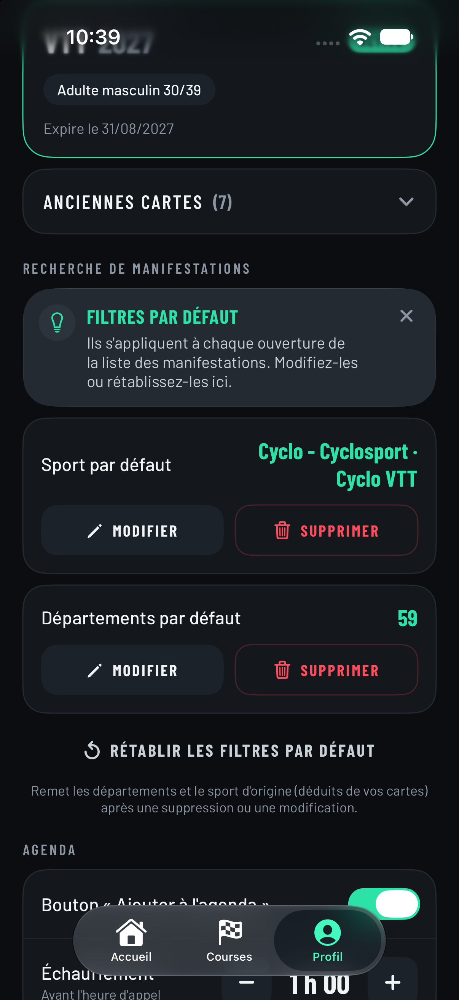

# Ma Saison Sport

<p align="center">
  
  
  
</p>

Application iPhone (SwiftUI) pour suivre ses manifestations sportives : cartes, inscriptions, manifestations par sport et département, inscription et paiement, ajout à l'agenda.

> **Application non officielle.** Elle n'est pas éditée par l'UFOLEP. Elle est réalisée bénévolement par Félix.

| | |
|---|---|
| Nom App Store | Ma Saison Sport |
| Nom affiché sous l'icône | Ma Saison |
| Identifiant (bundle ID) | `fr.lobwick.masaison` |
| Cible | iOS 26+, iPhone et iPad |
| Projet Xcode | `MaSaison.xcodeproj` |
| Pages publiques | [`docs/`](docs/) : [confidentialité](docs/confidentialite.md) · [assistance](docs/assistance.md) |

## Lancer le projet

Ouvrir `MaSaison.xcodeproj` dans Xcode, choisir un simulateur iPhone, lancer. La connexion utilise un compte « Mon espace licencié » de l'UFOLEP.

---

## Suivi TestFlight

### État

- [x] Identifiant `fr.lobwick.masaison` choisi et appliqué au projet
- [x] Application créée dans App Store Connect (« Ma Saison Sport »)
- [x] Workflow Xcode Cloud « Default » relié à ce dépôt
- [x] Politique de confidentialité et assistance (voir `docs/`)
- [ ] Publier ces fichiers sur GitHub (l'adresse de confidentialité ci-dessous n'existe qu'après)
- [ ] Remplir les champs entre crochets ci-dessous (e-mail, téléphone, compte de test)
- [ ] Workflow : action **Archive – iOS** + post-action **TestFlight Internal Testing**
- [ ] Premier build traité dans TestFlight
- [ ] Créer le groupe externe « Testeurs » + activer le lien public
- [ ] Remplir « Informations sur les tests » (textes ci-dessous)
- [ ] Beta App Review du premier build validée
- [ ] Diffuser le lien public

### Informations sur les tests — à coller dans App Store Connect

**Langue :** Français

**Adresse e-mail pour les commentaires**

```
[adresse e-mail publique à renseigner]
```

**URL marketing** (facultative)

```
https://github.com/Lobwick/MaSaison
```

**URL de la politique de confidentialité** (valide après publication du dépôt)

```
https://github.com/Lobwick/MaSaison/blob/main/docs/confidentialite.md
```

**Description de l'app bêta** (≤ 4000 caractères)

```
Ma Saison Sport t'aide à suivre ta saison sportive : tes cartes, tes inscriptions, les manifestations près de chez toi, l'inscription, le paiement et l'ajout à ton agenda.

IMPORTANT : application non officielle. Elle n'est pas éditée par l'UFOLEP ; elle est réalisée bénévolement. Pour l'utiliser, il faut déjà avoir un compte « Mon espace licencié » de l'UFOLEP : tu te connectes avec les mêmes identifiants que sur le site. Si tu n'as pas de compte, crée-le d'abord sur le site de l'UFOLEP.

CE QUE TU PEUX TESTER
• Accueil : ta prochaine course avec le compte à rebours, tes inscriptions à venir et terminées.
• Manifestations : la liste filtrée par sport et par département, avec en premier celles qui correspondent à tes cartes. Une icône indique celles où tu es déjà inscrit.
• Détail d'une manifestation : organisateur, état des inscriptions, lieu sur une carte, horaires d'échauffement, d'appel et de départ pour ta catégorie.
• Inscription de bout en bout : « S'inscrire », confirmation du tarif, validation puis paiement par carte bancaire sur la page de paiement du site, affichée dans l'application.
• Agenda : ajouter une course à ton calendrier, avec la durée d'échauffement que tu règles dans le Profil.
• Profil : tes cartes (les anciennes sont repliées), tes filtres par défaut (sport et départements), la durée d'échauffement.

À SAVOIR AVANT DE TESTER
• Les inscriptions et les paiements sont RÉELS : ils sont faits sur le vrai site de l'UFOLEP, auprès du vrai organisateur. Ne t'inscris qu'à une course à laquelle tu veux participer.
• L'application ne voit jamais ta carte bancaire : tu la saisis sur la page de la banque.
• Tes identifiants restent dans le trousseau de ton iPhone. Rien n'est envoyé à l'auteur de l'application.
• Il faut iOS 26 ou plus récent.

COMMENT DONNER TON AVIS
Utilise le partage de retour de TestFlight (capture d'écran + commentaire) ou écris à l'adresse indiquée. Dis-moi surtout : ce qui est confus, ce qui ne marche pas, ce qui manque. N'envoie jamais ton mot de passe.

Merci de tester !
```

**Personne à contacter**

| Champ | Valeur |
|---|---|
| Prénom | Félix |
| Nom | Moulin |
| Numéro de téléphone | `[à renseigner]` |
| E-mail | `[à renseigner]` |

**Informations de connexion** — cocher **« Connexion requise »**

| Champ | Valeur |
|---|---|
| Nom d'utilisateur | `[compte UFOLEP de test : identifiant]` |
| Mot de passe | `[compte UFOLEP de test : mot de passe]` |

> Ne jamais écrire ces identifiants dans ce fichier une fois remplis : ils ne doivent exister que dans App Store Connect. Le compte doit avoir au moins une carte active pour que l'application montre ses écrans.

**Remarques destinées à l'équipe de vérification** (en anglais, ≤ 4000 caractères)

```
Ma Saison Sport is an unofficial companion app for members of a French multi-sport federation (UFOLEP). It lets a member view their licence cards and event registrations, browse upcoming sports events filtered by sport and département, register for an event, pay the entry fee, and add the event to their calendar.

HOW TO SIGN IN
The app has no accounts of its own. It signs in to the federation's existing member portal ("Mon espace licencié") on the user's behalf, using the same username and password the user already has on the federation's website. The demo account is provided in the sign-in fields of this form. The credentials are stored only in the device Keychain and are sent only to the federation's website over HTTPS. The developer operates no server and receives no data.

WHAT TO TRY
1. Sign in with the demo account.
2. Home: upcoming and past registrations.
3. Courses tab: the list of events, filter button (sport and département).
4. Open an event: details, map, schedule for the user's category.
5. Profile: licence cards, default filters, warm-up duration setting, "Sign out".

REGISTRATION AND PAYMENT
Event entry fees are paid to the event organisers (sports clubs) for real-world sporting events, outside the app: the payment page of the federation's website, including its bank card page, is displayed inside the app. The app never sees or stores card data and sells no digital content, so no in-app purchase is involved. Please do NOT complete a payment or a registration with the demo account unless you have been told it is safe: you can review every screen, including the payment page, without confirming.

CALENDAR PERMISSION
The app requests write-only calendar access, only to add the event the user chooses. It does not read the calendar.

PRIVACY
Privacy policy: https://github.com/Lobwick/MaSaison/blob/main/docs/confidentialite.md
No advertising, no analytics, no third-party SDKs, no tracking.

NON-AFFILIATION
The app is independent and not published by the federation. It uses neither the federation's logo nor its artwork. Its name does not contain the federation's name.

Contact: [contact e-mail to fill in]
```

**Contrat de licence** : laisser vide (contrat standard d'Apple).
